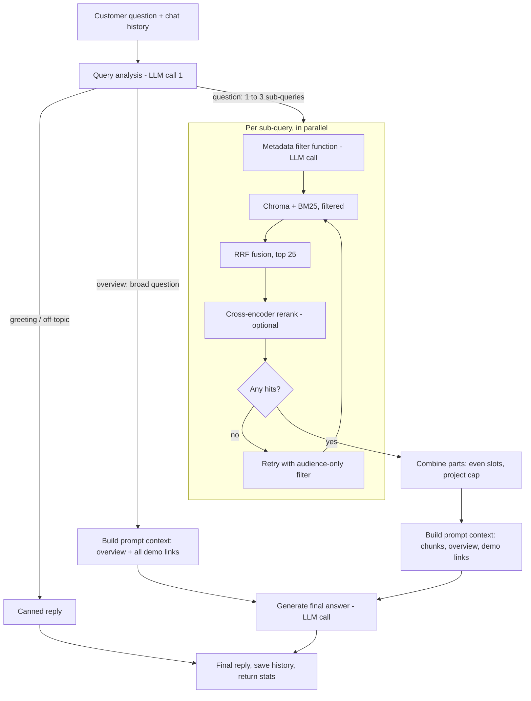

# AI Labs support chatbot (YoungSoft)

A retrieval-augmented chatbot (RAG) for a website that showcases YoungSoft's software projects to prospective clients.
Visitors are mostly non-technical, sometimes technical. The bot explains the projects in plain language, points to the
right one, hands over the demo link, and never invents features, prices or contacts.

The knowledge base is the 7 project READMEs in `documents/`. State of this document: **2026-10-13**.

---

## 1. Status at a glance

| Area | State |
|---|---|
| Indexing (chunking, metadata, embeddings, overview) | Done, rebuilt with `python data_loader.py` |
| Server (`rag_server.py`) and terminal client (`chat_client.py`) | Done and tested end to end with the real LLM |
| Question splitting (single / independent / connected), filters, hybrid search, optional rerank | Done and tested |
| "Overview" path for broad questions ("list your projects", "what do you do?") | Implemented and tested **offline with fake LLMs**. A run against the real model was still pending when this was written (the Groq daily token limit blocked it; the owner planned to test it by hand) |
| Project `status`, `timeline`, `completed_year` | **Placeholder values.** Never shown to the model or used as filters (`STATUS_IS_REAL = False`) |
| Website integration, auth, deployment, CORS | **Not built.** It is a local FastAPI service plus a terminal client |
| Automated tests in the repo | **None.** All tests were throw-away scripts kept outside the repo (see section 11) |

---

## 2. Quick start

Windows, PowerShell, from the project folder.

**First time only**

```powershell
python -m venv venv
.\venv\Scripts\Activate.ps1
pip install -r requirements.txt
```

Create `.env` in the project folder (never commit it, it is git-ignored):

```
GROQ_API_KEY=your_key_here
```

Build the index (chunks, metadata, Chroma, `chunks.pkl`, `overview.txt`). The first run downloads the two small models into `models/`:

```powershell
python data_loader.py
```

**Every day: two terminals**

```powershell
.\venv\Scripts\Activate.ps1
python rag_server.py
```

Wait for `Ready. Server running on http://127.0.0.1:8000` (about 20 s). Then in a second terminal:

```powershell
.\venv\Scripts\Activate.ps1
python chat_client.py --debug
```

Client commands: `/reset` (new conversation), `/debug` (toggle the per-stage table), `/quit`.

**Re-run `data_loader.py` and restart the server** whenever you change `documents/`, `PROJECT_META` or the section-classification rules.
If port 8000 is busy, an old server is still running; stop it first.

---

## 3. Repository map

| File | Purpose |
|---|---|
| `documents/*.md` | The 7 project READMEs (the knowledge base) |
| `config.py` | All settings, `PROJECT_META` (per-project metadata), classification keyword lists, canned messages |
| `data_loader.py` | Offline build: chunking, metadata, Chroma index, `chunks.pkl`, `overview.txt` |
| `rag_server.py` | The service. Loads everything once at startup, then answers questions via `/chat` |
| `chat_client.py` | Terminal chat for the server; prints the debug/stats table |
| `prompts.py` | The three prompts: query analysis, metadata filter, final answer |
| `schemas.py` | Pydantic schemas for the two structured LLM outputs (`Analysis`, `Filters`) |
| `model_store.py` | `ensure_model()`: download a Hugging Face model into `models/` once, then load it locally |
| `requirements.txt` | Dependencies |
| `eval_dataset.csv` | 37 evaluation questions with reference answers (git-ignored) |
| `answers_comparison*.csv/html` | Results of the original Chroma vs BM25 vs hybrid comparison (historical, old pipeline) |
| `test_run_report.html`, `test_run_results.csv` | Full answers and per-stage statistics for 29 questions on the final pipeline |
| `temp.py` | Small helper that prints one chunk and its metadata from `chunks.pkl` |
| Generated, git-ignored | `chroma/`, `chunks.pkl`, `overview.txt`, `models/`, `.env` |

Projects in the knowledge base (`PROJECT_META` keys): `scriber_agent`, `ai_listener`, `retell_caller_agent`,
`digital-prescription-virtual-assistant-platform`, `intelligent-reporting-system`, `siho_rag` (MyTruAdvantage chatbot), `ysi_ras`.
Four have a demo link (`demo_url`): Digital Prescription, Intelligent Reporting, MTA chatbot, YSIRas.

---

## 4. Architecture

Three phases: build once, load at startup, run per question.

### 4.1 Built offline (`data_loader.py`)

1. Split each README by Markdown headers (`#`, `##`, `###`) into chunks (109 in total). Each chunk text starts with `Project: <name> / Section: <h1 -> h2 -> h3>`.
2. Attach metadata to every chunk (section 5).
3. Embed all chunks with `BAAI/bge-small-en-v1.5` into a persistent Chroma index (`chroma/`). The old index is deleted first, because Chroma appends on re-run.
4. Save all chunks to `chunks.pkl` (used to build BM25 indexes in memory).
5. Write `overview.txt`: one line per project (display name, category, 1-2 sentence description from the first section). About 2 KB. Used as additional reference in every answer prompt, and as the sole source for broad questions.

### 4.2 Loaded once at server start (about 20 s)

`.env`, the embedding model, the Chroma index, the 109 chunks, the reranker model, `overview.txt`, the project/domain/tag lists, two prebuilt BM25 indexes (no filter; audience client+both), a warm-up search and rerank, and the Groq clients. Other BM25 filter combinations are built on first use and cached. Chat history lives in server memory only.

### 4.3 Per question (real time)



Step by step (`handle()` in `rag_server.py`):

1. Load the session history. Trim the message, cut it to 1,000 characters; an empty message returns the greeting with no LLM call.
2. **Query analysis (LLM call 1, `analyse()`):** structured output with `kind` (`greeting` | `off_topic` | `overview` | `question`), `relation` (`single` | `independent` | `connected`), `technical` (bool) and `sub_queries`.
3. Routing: greeting or off-topic returns a canned reply; overview skips search entirely; question continues.
4. Sub-queries are cleaned: duplicates and junk entries removed, extras beyond 3 merged into the last one so no question is dropped.
5. **Per sub-query, in parallel (`run_branch()`):**
   - **Metadata filter function (LLM call):** proposes `project`, `domain`, `tech_tags`. Code validates it (section 7).
   - Search Chroma and BM25 with the filters, fuse with RRF (top 25). A domain filter is a hint: the search also runs without it and the lists are fused.
   - Optional cross-encoder rerank (`USE_RERANKER`).
   - If the filters matched nothing, retry once with only the audience filter.
6. **Combine parts (`combine()`):** `TOTAL_CHUNKS` (8) slots are split evenly: `max(2, 8 // number_of_parts)` per part (1 part: 8, 2 parts: 4 each, 3 parts: 2 each). At most `MAX_PER_PROJECT` (3) chunks per project per part, unless a project was named. A part with no chunks is flagged "no relevant information".
7. **Prompt context:** chunks grouped by part, a "Demo links" block for the projects present, the overview as additional reference, the history, and a note `(Understood as: ...)` when the sub-queries differ from what the customer typed (so "yes" means something to the answer step).
8. **Final answer (LLM call 2 or later):** one answer covering every part.
9. Save the turn to the history (not saved if the answer model failed), return the answer plus `debug` and `stats`.

LLM calls per question: greeting/off-topic 1; overview 2; one-part question 3; N parts: 2 + N.

---

## 5. Metadata on every chunk

Set in `data_loader.py` from `PROJECT_META` (project level) and header classification (chunk level). Chroma only accepts str/int/float/bool.

| Field | Level | Meaning |
|---|---|---|
| `project` | project | file stem, e.g. `ysi_ras` |
| `display_name` | project | human name, e.g. "YSIRas Recruitment Assessment System" |
| `domain` | project | `healthcare`, `insurance`, `hr` |
| `project_category` | project | e.g. `clinical_documentation`, `recruitment` |
| `tech_tags` | project | comma string; also expanded to boolean fields `tag_<name> = True` (hyphens become underscores) |
| `demo_url` | project | only for the 4 projects that have one |
| `status`, `timeline`, `completed_year` | project | **placeholders**, unused |
| `section` | chunk | header path, e.g. `Chrome Extension > Installation > 4. Load the Extension` |
| `audience` | chunk | `client`, `developer` or `both` |
| `section_type` | chunk | `setup`, `overview_or_feature` or `technical` |

**Audience rule (`classify()`):** developer-only content is narrow on purpose (setup, install, commands, env vars, folder trees, API reference, license: keywords in `DEV_ONLY`, matched on the section's own header and its parent). Overview/feature/workflow style headers (`CLIENT_HINTS`, leaf header only) are `client`. Everything else is `both`. Rationale: hiding a client-relevant section is costly; showing a bit extra technical detail is cheap. Current split: 54 both, 29 developer, 26 client.

The client-facing filter is `audience in ["client", "both"]`. When the customer explicitly wants technical depth (`technical = true`), the audience filter is dropped.

---

## 6. Query analysis and splitting

Prompt: `ANALYSIS_PROMPT`. The model decides the **relation first**, then splits accordingly (the schema lists `relation` before `sub_queries`).

| Relation | Meaning | Splitting |
|---|---|---|
| `single` | One question. "And" or a list inside one question does not split it | One self-contained sub-query |
| `independent` | Different topics | One sub-query per question. Also: comparisons ("difference between X and Y" -> one per project) and "yes, and what does it cost?" (accepted offer + new question) |
| `connected` | Later part depends on an earlier one ("they", "those") | One per question, but later parts restate the subject: "How do the projects that use Groq produce clinical summaries?" |

Other behaviours: short replies ("yes", "sure", "ok go ahead") resolve to the bot's last offer; "no thanks"/"thanks" get a neutral reply; sub-queries are always written in English; at most 3 sub-queries (extras are merged); unrelated parts of a message are left out of the search (the answer prompt politely declines them); instruction-injection attempts are classified off-topic.

`kind = overview` is for broad questions about the company as a whole ("list your projects", "what do you do?", "what can you build?", "tell me about YoungSoft"). A question about one topic is still `question` even if it sounds general ("do you have a chatbot?").

---

## 7. Metadata filter function (and what code does with it)

Prompt: `FILTER_PROMPT`. The LLM proposes filters; **code decides what is applied** (`extract_filters()`):

- `project`: applied only if it is a real project id. Additionally, if the sub-query contains a project's display name ("Healthcare Conversational AI Demo"), the project is resolved in code (the model only sees the short ids). If two names appear, no project filter.
- `domain`: used only when no project is set. It is a **hint, not a wall**: the search runs with and without it and the results are fused, so cross-domain matches (a pharmacy locator in an insurance project for a question filed under healthcare) still surface.
- `tech_tags`: only real technologies (`FILTERABLE_TAGS`: python, fastapi, celery, redis, groq, ...), and only if the customer literally wrote the word. Feature-like tags (chatbot, dashboard, ai, bilingual) are never filters; they hid relevant projects.
- Audience: client+both unless the question is technical.

---

## 8. Retrieval details

- **Chroma:** vector similarity search over bge-small embeddings, top 20, metadata filter applied inside Chroma (`$in`, `$eq`, `$and`).
- **BM25:** `rank_bm25` over the chunks that pass the same filter. Tokenizer `[a-z0-9]+` on lowercased text, so `RETELL_API_KEY` becomes `retell api key`. One retriever per filter combination, cached.
- **RRF:** reciprocal rank fusion, `k = 60`, keeps the top 25.
- **Reranker (optional):** `cross-encoder/ms-marco-MiniLM-L-6-v2`, `max_length` 256, batch 16, all CPU cores, runs under a lock (parallel sub-queries rerank one after another). No LLM involved. Off when `USE_RERANKER = False`: hybrid order is kept.
- **Retry wider:** if the filters match nothing (`MIN_CANDIDATES = 1`), repeat with only the audience filter. Filters keep or drop whole projects, so a wrong guess gives 0 hits; a threshold of 5 once wrongly dropped the project filter for the call agent (only 4 client chunks).
- **No score cut-off:** `MIN_RELEVANCE = None`. Raw reranker scores could not separate answerable questions from off-topic ones (see section 10).

---

## 9. Answer generation

Prompt: `ANSWER_PROMPT`. Key rules:

1. Base the answer on the retrieved context; use the project overview as additional reference. Never invent clients, deployments, results, prices, timelines, contacts, features, steps, examples or numbers.
2. Answer every part in order; if a part has no information, say it is not covered in the documentation and suggest talking to the team (no made-up email/phone).
3. Language level: plain and non-technical by default; technical when asked.
4. Short and warm. Include a demo link only if listed under "Demo links" or in the context; never say a demo does not exist; if asked for a demo and none is listed, point to the team without promising to arrange one.
5. End with one next step chosen only from: explain more, a related project, the demo link, talk to the team. Never promise a live demo, walkthrough, video, call, trial, quote or meeting.
6. Decline anything unrelated.

Models: `openai/gpt-oss-20b` via Groq for all three LLM calls. Router temperature 0, answer temperature 0.4.
Structured outputs use `method="json_schema"`; LangChain's default (tool calling) fails with this model on Groq.

---

## 10. API and debug output

`rag_server.py` (FastAPI, `127.0.0.1:8000`):

| Endpoint | Body | Returns |
|---|---|---|
| `POST /chat` | `{"session_id": str, "message": str}` | `{"answer", "debug", "stats"}` |
| `POST /reset` | `{"session_id": str, "message": ""}` | `{"ok": true}`; deletes that session's history. The client also switches to a new session id |
| `GET /health` | none | `{"status": "ready", "chunks": 109}` |

`debug`: `kind`, `relation`, `technical`, `sub_queries`, and per part `branches[{query, filters, relaxed, top_scores}]` and `sources[{part, chunks[{project, section, score}]}]`.
`stats`: `analysis`, `branches[{query, filters{seconds, input_tokens, output_tokens, retries?, error?}, chroma_s, bm25_s, rrf_s, rerank_s, rerank_pairs, attempts}]`, `retrieval_wall_s`, `combine_s`, `generation`, `total_s`, `tokens{llm_calls, input, output, total}`.
`chat_client.py --debug` prints this as a per-stage table with latencies and token counts.

**History:** the last `MAX_HISTORY_TURNS = 6` turns are sent to the analysis and answer prompts; at most 18 are kept in memory; answers are stored in full (they cost tokens); sessions are never expired; a restart clears everything; a failed turn is not saved.

**Errors:** every LLM call retries up to twice (waits the time Groq suggests, max 10 s; no retry on 401). If analysis fails, the raw question is used as one sub-query; if the filter call fails, audience-only; if the answer call fails the customer gets "Sorry, I'm having trouble answering right now..." (HTTP 200) and the turn is not saved.

---

## 11. Configuration reference (`config.py`)

| Setting | Value | Meaning |
|---|---|---|
| `EMBEDDING_MODEL` | `BAAI/bge-small-en-v1.5` | embeddings (must match the index) |
| `RERANKER_MODEL` | `cross-encoder/ms-marco-MiniLM-L-6-v2` | alternative: `BAAI/bge-reranker-base` (about 6x slower here, no retrieval gain) |
| `USE_RERANKER` | `True` | `False` keeps the hybrid order |
| `RERANK_MAX_LENGTH`, `RERANK_BATCH_SIZE` | 256, 16 | rerank speed |
| `ROUTER_MODEL`, `ANSWER_MODEL` | `openai/gpt-oss-20b` | Groq models |
| `POOL_SIZE` | 20 | results per retriever |
| `RERANK_POOL` | 25 | fused candidates kept |
| `RRF_K` | 60 | RRF constant |
| `MIN_CANDIDATES` | 1 | retry wider only when filters match nothing |
| `MIN_RELEVANCE` | `None` | no score cut-off |
| `TOTAL_CHUNKS` | 8 | chunks sent to the answer model, split evenly across parts |
| `MAX_PER_PROJECT` | 3 | per-part cap per project (off when a project is named) |
| `MAX_SUBQUERIES` | 3 | max sub-queries per message |
| `MAX_HISTORY_TURNS` | 6 | turns sent to the model |
| `CLIENT_AUDIENCES` | `["client", "both"]` | client-facing audience filter |
| `STATUS_IS_REAL` | `False` | flip to `True` only after status/timeline are real |
| `GREETING`, `OFF_TOPIC` | text | canned replies |
| `FILTERABLE_TAGS` | list | technologies allowed as filters |

In `rag_server.py`: `MAX_QUESTION_CHARS = 1000`, `CONTINUE` (neutral reply for thanks/no-thanks mid-conversation), `UNAVAILABLE`, `JUNK_SUBQUERIES`.

---

## 12. Evaluation and findings (measured)

**Original comparison (old pipeline, LLM-judged by Claude, 37 questions, overall score out of 5):**
Chroma 4.43, BM25 alone 3.90, hybrid (RRF) 4.45. BM25 alone hallucinated on exact-term questions; Chroma and hybrid were within noise. By type: lookups 4.63 / 3.50 / 4.50, client paraphrases 4.33 / 4.33 / 4.67, multi-hop 4.48 / 3.82 / 4.12, out-of-scope 3.80 / 4.00 / 4.53. The worst single failure was an invented email and phone number on a pricing question, caused by the old "never say no" prompt rule.

**Reranker study (34 answerable questions, does a chunk containing the answer land in the top k):**

| | top 2 | top 3 | top 6 | time for ~25 chunks |
|---|---|---|---|---|
| Hybrid only | 25 | 26 | 30 | 0 |
| MiniLM reranker | 24 | 28 | 31 | about 1 s |
| `bge-reranker-base` | not measured at chunk level | not measured at chunk level | not measured at chunk level | about 25 s, 6 s after tuning. At project level it matched MiniLM, so it was dropped for speed |

The reranker is a small, mixed net gain (gained 4 questions at top 3, lost 2), so it is kept on but optional. Reranker scores cannot separate answerable questions from off-topic ones (colloquial client questions score as low as "capital of France"), which is why there is no score cut-off.

**Latency and cost on the final pipeline (25 real questions):**
greeting/chat 0.7 to 1.1 s (1 call); single question 3.1 to 4.5 s (3 calls); 2 to 3 parts 3.8 to 9.4 s (4 to 5 calls); average 6.1 s over questions that searched; about 4,900 tokens per question; occasional outliers (11 to 26 s) from automatic retries. Chroma 0.04 to 0.08 s, BM25 about 0.01 s, rerank 0.2 to 1.3 s per sub-query. Server start about 20 s (16 to 43 s observed).

**Groq limits (important):** the free tier allows 200,000 tokens per day **per organization** for this model (not per key), 8,000 per minute, 1,000 requests per day. At about 4,900 tokens per question that is roughly 40 questions a day. Tests burn the same budget as real use. Capacity returns gradually on a rolling 24-hour window. A paid tier is required for a live site.

**Full results:** `test_run_report.html` has 29 questions with complete answers and per-stage statistics (rows 26 to 29 are from earlier same-day runs because the daily limit was hit).

---

## 13. Decisions and lessons (why it is the way it is)

- Hybrid search (dense + BM25) because dense misses exact tokens (ports, env vars, commands) and BM25 misses paraphrases.
- Narrow developer-only labelling and an audience filter so clients do not get setup commands, while technical users still can.
- `json_schema` structured output: the default tool-calling method failed on every call with `gpt-oss-20b` on Groq.
- Domain is a hint because the model filed "pharmacy locator" under healthcare while the real locator is in an insurance project.
- Only real technologies filter, and only if named, because a "chatbot" tag narrowed a generic question to a single project.
- `MIN_CANDIDATES = 1`, see section 8.
- The answer prompt forbids invented features, examples and promises because earlier runs produced "we'll arrange a live demo", "short video", invented example questions, and a false claim that a demo link did not exist. Demo links now come from `PROJECT_META` so the model always sees them.
- Splitting decides `relation` first because a later part like "how do they produce summaries?" lost its subject when split blindly.
- The overview path exists because "list the projects" has no matching chunk: retrieval returned noise and the answer step may ignore the overview. Broad questions now skip search and cost 2 calls instead of 3.
- Overview text is clean one-liners (about 2 KB) instead of raw first chunks (3.5 KB).
- The reranker defaults to the small MiniLM model: the larger one was 6 to 25x slower on this CPU with no gain.

---

## 14. Known limitations and ideas

- Status/timeline/completed year are placeholders; no status or year filter exists.
- The `technical` flag applies to the whole message: mixing a client question and a technical one makes the client part also see developer chunks.
- Answers to questions that mention a technology can include more technical detail than a client wants (file names, env vars).
- A few oddly phrased questions still retrieve the wrong project (for example "rings patients who skipped sessions and rebooks them" ranks Scriber above the call agent). Not yet fixed.
- Parallel sub-queries rerank one at a time (lock), up to about 3 s for 3 parts.
- Chat history is in memory, unbounded in session count, answers stored in full (token cost grows with conversation length).
- No authentication, rate limiting, CORS, HTTPS, or deployment setup; it is a development server on localhost.
- Cheaper history (truncate stored answers), per-part technical flag, merging the analysis and filter calls into one, a self-check step for unsupported claims, and a proper `tests/` folder are the natural next steps.

---

## 15. Testing guide

Questions that exercise each path (all were run against the real model unless noted):

| Path | Ask | Expect in `--debug` |
|---|---|---|
| Greeting | `hi` | `kind: greeting`, 1 call |
| Off-topic | `What's the weather in Chennai today?` | `kind: off_topic`, canned reply |
| Overview (offline-tested only) | `can you list out the projects?` | `kind: overview`, no sub-queries, 2 calls, all 7 projects |
| Single | `Do you have anything that saves doctors from typing up notes after each visit?` | `relation: single`, 3 calls, Scriber |
| Follow-up | then `yes` | resolves to "explain in more detail how the Scriber Agent works" |
| Honest refusal | `Can you tell me the price of the Scriber Agent subscription?` | says pricing is not documented, no invented contacts |
| Technical | `How do I start celery beat?` | `technical: True`, the exact command from the README |
| Connected | `Which projects use Groq, and how do they produce clinical summaries?` | `connected`; part 2 restates "projects that use Groq" and gets the Groq filter |
| Independent (3) | `What do you have for hiring, can your tools help insurance members find a nearby pharmacy, and how do you protect patients from dangerous medicine combinations?` | `independent`, 3 sub-queries, 5 calls |
| Comparison | `What's the difference between the Scriber Agent and the Healthcare Conversational AI Demo?` | one sub-query per project, each with a project filter |
| Accept + new | after a Scriber answer: `yes, and also what does it cost?` | two sub-queries; pricing not documented |
| Over the limit | `Do you have a hiring tool? What about a pharmacy locator? Do you check drug interactions? And do you make voice calls to patients?` | 3 sub-queries, the last two merged |
| One part off-topic | `What do you have for hiring, and what's the weather in Chennai?` | only the hiring part is searched |

The offline checks used while building (fake LLMs, no tokens) covered: the filter builder and BM25 filtering, retry-wider, tag/display-name/domain rules, sub-query cleaning, the overview path (zero filter calls, zero searches), empty and oversized messages, history trimming, and the model-unavailable path. They lived in a scratch folder and are not in the repo.

---

## 16. Notes for an AI assistant continuing this work

- **Do not print or commit `.env`.** It holds the Groq key.
- **Check what is on port 8000 before stopping anything.** The owner often runs their own `rag_server.py`; start test servers on another port (`python -c "import uvicorn, rag_server; uvicorn.run(rag_server.app, host='127.0.0.1', port=8010)"`) and stop only your own processes.
- **Real-model tests spend a shared daily budget** (about 5k tokens per question). Prefer offline tests with fake LLMs for logic; save real runs for prompt behaviour. Do not probe the quota with a large `max_tokens`: it is not counted, so the probe over-reports capacity. The refusal message states the real usage ("Used X of 200000").
- `config.py` was once overwritten by the owner's editor with an older copy, undoing edits. Re-check it after editing.
- The owner prefers: verify claims with a test, say plainly what was and was not tested, and do not change prompts or files they did not ask about. Mention any such change you make.
- After changing `documents/`, `PROJECT_META`, or `data_loader.py`, re-run `python data_loader.py`, and restart any running server so it loads the new index, `overview.txt` and prompts.
- On Windows the Git Bash shell mangles complex quoting in heredocs; write scripts to files instead.

---

## 17. Glossary

- **RAG:** retrieval-augmented generation. Find relevant text first, then let the model answer from it.
- **Chunk:** one section of a README stored and searched as a unit.
- **Embedding / Chroma:** numbers that capture meaning; Chroma is the vector database that searches them.
- **BM25:** classic keyword search, strong on exact terms.
- **RRF:** reciprocal rank fusion, merges two ranked lists by rank, not score.
- **Cross-encoder reranker:** a small model that scores each (question, chunk) pair directly. No LLM call.
- **Metadata filter:** restricting search by labels such as project, audience or technology.
- **Sub-query:** one self-contained search question produced by splitting a customer message.
- **Overview:** `overview.txt`, a short list of all projects used as additional reference and as the source for broad questions.
- **TPD / TPM:** Groq tokens per day / per minute limits.
